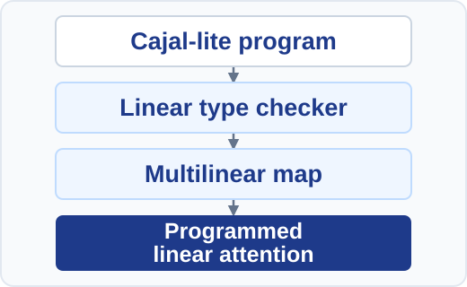
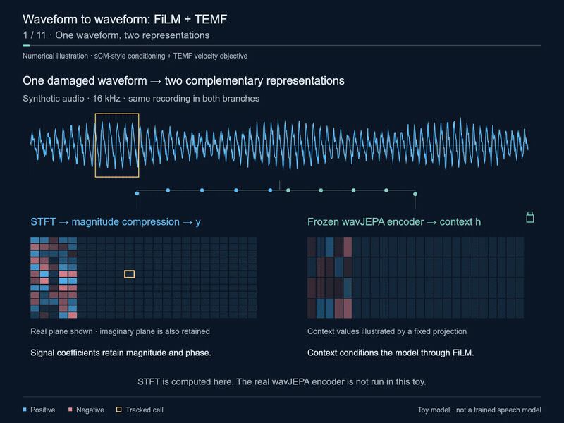
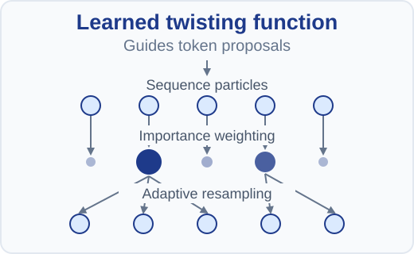
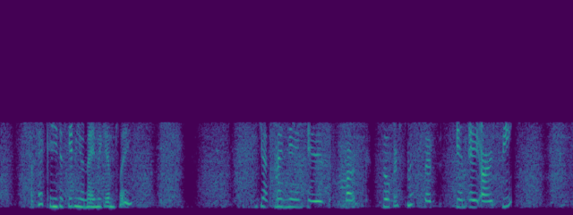
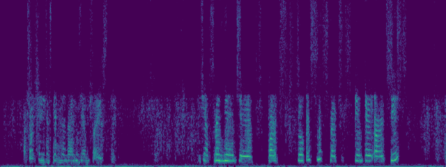
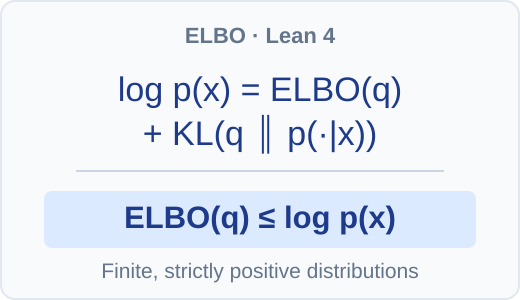

# Quang Nguyen

**ML research** · [Website](https://quangng2000.github.io/)

I focus on machine learning research. My projects explore program compilation into transformer components, speech restoration with pretrained audio representations, language-model steering with learned twisting functions and sequential Monte Carlo, and formal proofs of the mathematical foundations of learning.

I'm also a **contributor and maintainer of [LemmaScript](https://github.com/midspiral/LemmaScript)**, a verification toolchain for TypeScript.

## Research interests

- Program compilation and neuro-symbolic learning in transformers
- Speech restoration, audio representations, and mean-flow generative models
- Probabilistic inference and language-model steering with twisted SMC
- Probabilistic modeling and formal verification of machine learning foundations

## Selected work

<table>
  <tr>
    <td width="32%" valign="top">
      
    </td>
    <td valign="top">
      <h3><a href="https://github.com/quangng2000/riftco-transformer">Cajal Compiler to Transformer Heads</a></h3>
      
Compiling typed Cajal-lite programs into programmed transformer components, including linear-attention heads, and combining them with learned components.

      
<a href="https://github.com/quangng2000/riftco-transformer">Code</a> · <a href="https://quangng2000.github.io/projects/riftco-transformer/">Project details</a>

    </td>
  </tr>
  <tr>
    <td width="32%" valign="top">
      
       Toy method illustration; not trained speech output.
    </td>
    <td valign="top">
      <h3><a href="https://github.com/quangng2000/temf-wavjepa-film">TEMF + WavJEPA-Nat (FiLM)</a></h3>
      
A speech-restoration research prototype combining frozen WavJEPA-Nat features, FiLM conditioning, and TEMF mean-flow generation.

      
<a href="https://github.com/quangng2000/temf-wavjepa-film">Code</a> · <a href="https://quangng2000.github.io/projects/temf-wavjepa-film/">Project details</a>

    </td>
  </tr>
  <tr>
    <td width="32%" valign="top">
      
    </td>
    <td valign="top">
      <h3><a href="https://quangng2000.github.io/projects/smc-steering/">SMC Steering with Learned Twisting Functions</a></h3>
      
Inference-time language-model steering with contrastive twist learning, importance weighting, and adaptive SMC resampling.

      
<a href="https://quangng2000.github.io/projects/smc-steering/">Project details</a>

    </td>
  </tr>
  <tr>
    <td width="32%" valign="top">
      Input 
      
       20 inference steps 
      
    </td>
    <td valign="top">
      <h3><a href="https://github.com/quangng2000/rmfsr">RMFSR</a></h3>
      
An independent experimental implementation of MeanFlow speech restoration, with PyTorch models and training and evaluation tools.

      
<a href="https://github.com/quangng2000/rmfsr">Code</a> · <a href="https://quangng2000.github.io/projects/rmfsr/">Project details</a>

    </td>
  </tr>
  <tr>
    <td width="32%" valign="top">
      
    </td>
    <td valign="top">
      <h3><a href="https://github.com/quangng2000/lean-elbo">ELBO in Lean 4</a></h3>
      
A Lean 4 formalization of the evidence lower bound for finite, strictly positive probability distributions.

      
<a href="https://github.com/quangng2000/lean-elbo">Code</a> · <a href="https://quangng2000.github.io/projects/lean-elbo/">Project details</a>

    </td>
  </tr>
</table>

More project notes and demonstrations are on my [website](https://quangng2000.github.io/).
